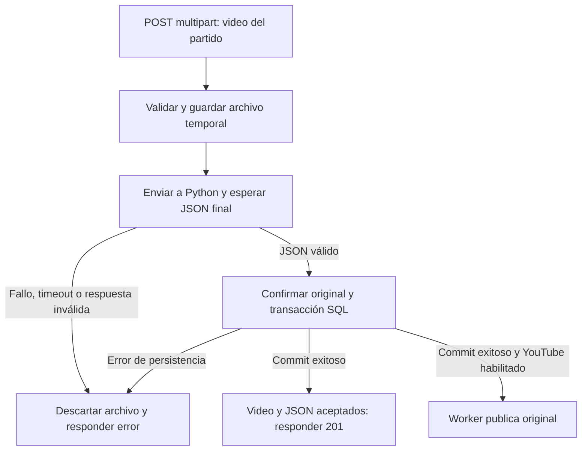

# Carga atómica de video condicionada al JSON del analizador

Fecha: 2026-10-23. Plan e implementación de la integración automática.

**Estado: implementado en el backend.** Se conserva la secuencia y los criterios del plan como referencia de diseño. La comprobación contra el servicio Python real queda pendiente de su endpoint y contrato. Esta revisión sustituye el diseño anterior de dos envíos independientes al cargar: si el analizador falla o no devuelve su JSON final, se cancela la carga del video y no se publica en YouTube.

`VideoPartidoService.create` prepara y valida el archivo, solicita la evaluación y espera su `CompletableFuture` con plazo acotado. Solo un JSON válido permite confirmar `VideoPartido` y `AnalysisJob` completado en una transacción corta. El controlador conserva su ruta, respuesta y DTO; la petición ocupa un hilo servlet durante la espera. `AnalysisConcurrencyLimiter` comparte el límite local de evaluaciones entre cargas y worker manual. `AnalysisUploadException` permite devolver los fallos remotos como `502` o `504` sin exponer el cuerpo de Python.

## 1. Regla acordada

Una sola carga recibe el archivo, lo valida y lo envía al analizador Python. Python devuelve una única respuesta JSON final. **La carga solo se acepta cuando ese JSON válido se recibió y pudo guardarse junto al video.**

Si Python no devuelve nada, falla la conexión, vence el timeout o la respuesta es inválida, descartar el archivo temporal, no crear un video definitivo y no publicar en YouTube. El frontend debe recibir un error, nunca una confirmación de carga exitosa.

YouTube es un agregado. Su publicación comienza después de aceptar el video con su JSON, usando el mismo original. Python no descarga el video desde YouTube.



## 2. Atomicidad y orden de las operaciones

La unidad de aceptación es **video + respuesta JSON del analizador**. Ambos quedan disponibles juntos o la carga falla. La confirmación SQL incluye además el estado pendiente de YouTube, si está habilitado.

La llamada a Python se hace fuera de una transacción SQL. No mantener conexiones de base de datos ni bloqueos durante la inferencia. Implementar preparación del archivo, evaluación, transacción corta y compensación del archivo si falla la confirmación.

YouTube es externo y no participa en una transacción PostgreSQL. Para evitar que un análisis fallido deje un video publicado, **no enviar a YouTube en paralelo con la evaluación**: habilitar su worker únicamente después de recibir el JSON y confirmar video y análisis. El worker puede comenzar después del commit aunque el cliente todavía no haya recibido el `201`.

Si YouTube falla después, conservar el video y el JSON aceptados, registrar el error de publicación y permitir su reintento. La cancelación solicitada se aplica al fallo del analizador durante la carga; YouTube mantiene su carácter opcional.

## 3. Documentación de partida

- [HU01: carga, almacenamiento y YouTube](HU01_CARGA_VIDEOS.md).
- [HU02/HU03: transporte vigente del analizador](HU02_HU03_ANALISIS.md).
- [HU12: modelo e integridad de métricas](HU12_MODELO_INTEGRIDAD.md).
- [Base de datos y migraciones](BASE_DATOS_DOCKER.md).
- [Configuración de YouTube](YOUTUBE_SETUP.md).
- [Plan de HU01 y HU12–HU16](../PLAN_VIDEO_DATA_ANALYSIS.md).
- [TSV de historias de usuario](../Análisis%20de%20Rendimiento%20para%20Fútbol%20-%20Product%20Backlog.tsv).

HU02/HU03 documenta también el POST manual con `202`, worker y Future, conservado para videos anteriores sin análisis. Las cargas nuevas reutilizan el transporte multipart y la validación, y ya incluyen el análisis. `PLAN_HU02_HU03_ANALISIS.md` describe un protocolo anterior y es histórico.

## 4. Secuencia implementada

### Preparar sin aceptar

1. Validar partido y configuración del analizador. Si está deshabilitado o mal configurado, rechazar la carga; no convertirla silenciosamente en un guardado sin análisis.
2. Aplicar los límites actuales de tamaño y nombre.
3. Copiar con `LocalVideoStorage.stage` e inspeccionar con `FfmpegVideoInspector`.
4. Mantener `upload.part` como temporal: todavía no hay video definitivo ni publicación pendiente en SQL.

### Evaluar antes de confirmar

5. Enviar `staged.path()` a Python con `AnalysisGateway`, mediante multipart `file`. El nombre transmitido puede seguir siendo `video.mp4` aunque el temporal local tenga extensión `.part`.
6. Esperar el Future fuera de la transacción SQL, con un plazo acotado por `ANALYSIS_REQUEST_TIMEOUT`. La solicitud pública permanece pendiente hasta conocer el resultado. La implementación usa espera síncrona en el hilo servlet; el HTTP no se confirma anticipadamente.
7. Aceptar exclusivamente `200` con objeto/arreglo JSON válido, respetando `AnalysisResultValidator` y el límite de bytes existente.
8. Ante fallo, ausencia de resultado o timeout, cancelar la carga y compensar el archivo. No reenviar automáticamente una inferencia cuyo resultado sea incierto.

La ausencia de respuesta se detecta con timeout; no esperar indefinidamente. `204`, cuerpo vacío, JSON `null`, contenido truncado, error HTTP y `202` remoto no acreditan éxito. Los objetos/arreglos vacíos son JSON estructurado según el validador actual; no inventar reglas de métricas sin acordar antes el contrato de negocio.

### Persistir video y JSON juntos

9. Con JSON validado, confirmar el original con `storage.commit`.
10. En una transacción SQL corta, volver a validar el partido y guardar `VideoPartido` junto con un `AnalysisJob` ya `COMPLETADO`, que conserve `respuestaJson`.
11. En esa misma transacción, dejar YouTube `PENDIENTE` si está habilitado o `DESHABILITADO` si no lo está.
12. Devolver `201 Created`, metadatos y `Location` del video únicamente después del commit exitoso.

Al construir el análisis completado, respetar las restricciones: fechas coherentes de solicitud, inicio, fin y actualización; `proximaEjecucion`, `claimToken` y `leaseUntil` nulos. Conservar que la evaluación ya se envió. Mantener `resultadosDisponibles=false` hasta la publicación de métricas de HU12.

No se inserta primero un análisis `PENDIENTE` que el worker pueda reclamar: la carga ya evalúa el archivo y se duplicaría la llamada. La creación manual mediante `AnalysisJobService.create` conserva su trabajo pendiente para videos anteriores, por una ruta separada.

### Adaptar correlación y concurrencia

El gateway recibe una correlación textual y la ruta del original. La evaluación de una carga ocurre antes de tener un ID persistido, por lo que utiliza un UUID. El worker convierte su ID numérico a texto. `X-Analysis-Id` es informativa; Python no tiene que devolverla.

No persistir un video aceptado ni inventar un ID numérico para resolver la correlación. Crear el `AnalysisJob` real al confirmar; Spring conserva el contexto durante la operación.

Las cargas directas y el worker comparten `ANALYSIS_MAX_CONCURRENT_JOBS` mediante `AnalysisConcurrencyLimiter`, por instancia. El cupo se libera ante éxito, error y cancelación. Sin capacidad, la carga devuelve `503` y limpia la preparación; no hay una cola ilimitada en memoria. El límite local no controla otras instancias de Spring.

## 5. Fallos y compensación

| Situación | Resultado requerido |
| --- | --- |
| Archivo inválido o partido inexistente | Error de validación; sin evaluación ni publicación. |
| Analizador deshabilitado o sin configurar | Error explícito; no aceptar video sin JSON. |
| Python inaccesible, error HTTP o JSON inválido | Cancelar carga, limpiar temporal y no crear video definitivo. |
| Python no responde dentro del plazo | Cancelar por timeout y limpiar archivo; nunca devolver `201`. |
| JSON recibido pero falla SQL/commit | Rollback de video y análisis; limpiar original confirmado; YouTube no arranca. |
| Video y JSON confirmados; luego falla YouTube | Conservar carga y resultado; registrar error y permitir reintento de publicación. |

La compensación debe cubrir también el fallo de commit, como ya permite el `TransactionTemplate` actual. Coordinar cancelación del intercambio HTTP y cierre de recursos antes de limpiar el archivo que pueda estar leyéndose.

Cancelar el Future no garantiza que Python detenga su inferencia. Si recibió los bytes y Spring perdió la respuesta, la carga local falla y no se publica; no repetir automáticamente la evaluación.

Un cierre abrupto puede dejar temporales o un directorio sin registro; documentar conciliación y limpieza operativa. No prometer una transacción distribuida entre disco, Python, SQL y YouTube, ni que el cliente recibió el `201` si pierde conexión después del commit.

Los fallos previos a la aceptación pueden registrarse en logs controlados, sin conservar un video de negocio rechazado. No insertar un `AnalysisJob` huérfano: su FK a video es obligatoria. Una auditoría durable de cargas fallidas requeriría una entidad de intento separada, fuera de esta entrega.

## 6. API y frontend

| Ruta | Comportamiento implementado |
| --- | --- |
| `POST /api/v1/partidos/{partidoId}/videos` | Recibir `file`, esperar JSON y persistencia; devolver `201` solo si ambos tuvieron éxito. |
| `GET /api/v1/partidos/{partidoId}/videos/{videoId}` | Consultar metadatos y estado de YouTube del video aceptado. |
| `GET /api/v1/partidos/{partidoId}/videos/{videoId}/analisis` | Descubrir el análisis completado durante la carga. |
| `GET /api/v1/analisis/{id}` | Consultar estado y disponibilidad; el JSON crudo sigue siendo interno. |

Conservar `400`, `404`, `413` y `ProblemDetail` existentes. Incorporar o adaptar mapeos para `502` por fallo/respuesta inválida de Python, `504` por timeout y `503` por integración deshabilitada o falta de capacidad. No exponer cuerpos remotos ni credenciales.

El frontend muestra la carga en espera mientras Python procesa. Solo muestra éxito al recibir `201`; ante error informa la cancelación. No debe ejecutar un segundo POST de análisis. Mantener el POST manual existente para videos antiguos sin análisis, con `409` si ya existe uno. HU16 sigue pendiente para reprocesos explícitos.

El DTO del video se mantiene; el análisis se descubre con su GET de listado. El POST de carga no devuelve `202` ni muestra un video aceptado antes del JSON. Una preparación asíncrona durable requeriría otro contrato que distinga preparación de aceptación.

Ajustar timeouts de cliente, proxy y servidor al tiempo de validación más evaluación y commit. La implementación actual espera en el hilo servlet; si luego se migra a respuesta asíncrona MVC, ajustar también su timeout. Un Future no reduce la duración de la conexión HTTP.

### Ejemplo de uso

Con Python levantado y un partido existente, configurar y exportar las variables de la sección siguiente y reiniciar el backend. Reemplazar los IDs por los que devuelva la API:

```bash
# Este POST permanece pendiente durante validación y evaluación.
curl --fail-with-body -i \
  -F 'file=@cronoshift.mp4;type=video/mp4' \
  http://localhost:8080/api/v1/partidos/1/videos

# Después del 201, consultar el análisis que ya se creó.
curl --fail-with-body \
  http://localhost:8080/api/v1/partidos/1/videos/1/analisis

# Consultar el ID de análisis obtenido en el listado.
curl --fail-with-body http://localhost:8080/api/v1/analisis/1
```

El GET del análisis muestra `estado=COMPLETADO`, `respuestaRecibida=true` y `resultadosDisponibles=false`. El texto JSON original sigue siendo interno; recibirlo no publica métricas por jugador. Un segundo POST manual de análisis para ese video devuelve `409`.

## 7. Configuración

```dotenv
VIDEO_STORAGE_DIR=.local/videos
VIDEO_YOUTUBE_ENABLED=true
VIDEO_YOUTUBE_PYTHON=.local/youtube/venv/bin/python
VIDEO_YOUTUBE_CHANNEL=Semillero-Video-Analysis

ANALYSIS_ENABLED=true
ANALYSIS_BASE_URL=http://localhost:8000
ANALYSIS_EVALUATION_PATH=/internal/v1/evaluaciones
ANALYSIS_REQUEST_TIMEOUT=2h
ANALYSIS_MAX_CONCURRENT_JOBS=1
```

Adaptar la URL al servicio real. El análisis es obligatorio para aceptar nuevas cargas bajo este contrato: `ANALYSIS_ENABLED=false` debe rechazarlas. YouTube deshabilitado permite aceptar video + JSON sin publicación externa.

Conservar los valores seguros de la plantilla y documentar su habilitación. No introducir un bypass implícito para desarrollo; las pruebas pueden simular el gateway y devolver JSON.

Se requieren PostgreSQL, FFmpeg/ffprobe y el servicio analizador. YouTube requiere además su entorno Python y OAuth válido. La aplicación no carga `.env` automáticamente: exportar sus variables o configurarlas en el IDE. Docker Compose solo levanta PostgreSQL; el script de YouTube no realiza análisis.

## 8. Archivos de la implementación

Rutas relativas a la raíz:

| Archivo | Trabajo |
| --- | --- |
| `core/src/main/java/edu/upb/semillero/service/VideoPartidoService.java` | Preparación, evaluación previa, transacción final y compensación. |
| `core/src/main/java/edu/upb/semillero/service/analysis/AnalysisGateway.java` | Correlación anterior a la persistencia del análisis. |
| `core/src/main/java/edu/upb/semillero/service/analysis/HttpAnalysisGateway.java` | Reutilizar multipart/Future y adaptar correlación. |
| `core/src/main/java/edu/upb/semillero/service/analysis/AnalysisResultValidator.java` | Preservar validación de transporte. |
| `core/src/main/java/edu/upb/semillero/service/AnalysisJobService.java` | Conservar creación manual existente y conflicto si el video ya tiene análisis. |
| `core/src/main/java/edu/upb/semillero/service/analysis/AnalysisWorker.java` | Preservar flujo existente y compartir cupo de concurrencia. |
| `core/src/main/java/edu/upb/semillero/service/analysis/AnalysisConcurrencyLimiter.java` | Compartir el cupo de evaluación entre cargas directas y worker manual. |
| `semillero-api/src/main/java/edu/upb/semillero/controller/VideoPartidoController.java` | Mantener ruta y DTO; responder después de la aceptación del servicio. |
| `core/src/main/java/edu/upb/semillero/service/exception/AnalysisUploadException.java` y `semillero-api/src/main/java/edu/upb/semillero/controller/exception/` | Mapear fallos del analizador durante la carga como errores HTTP controlados. |
| `semillero-api/src/test/java/edu/upb/semillero/VideoPartidoIntegrationTest.java` | Cubrir aceptación condicionada y limpieza ante fallos. |
| `semillero-api/src/test/java/edu/upb/semillero/AnalysisJobIntegrationTest.java` | Conservar creación manual y conflictos sin doble evaluación. |
| `semillero-api/src/test/java/edu/upb/semillero/AnalysisPostgresIntegrationTest.java` | Verificar persistencia conjunta y rollback en PostgreSQL desechable. |
| `.env.example`, `README.md`, `docs/HU01_CARGA_VIDEOS.md`, `docs/HU02_HU03_ANALISIS.md` | Documentar aceptación atómica, dependencia de Python y duración de la solicitud. |

Reutilizar el esquema existente cuando alcance. Preservar la columna JSON de la migración 004 y las restricciones de la 002. No crear estados ficticios de análisis pendiente para una respuesta ya recibida.

Recibir JSON no publica métricas por jugador. HU12 conserva sus pendientes: dorsal/equipo, unidades, validación de negocio y versiones. `COMPLETADO` y `respuestaRecibida=true` no implican `resultadosDisponibles=true`.

## 9. Pruebas y cierre

Usar Futures controlados y publicador simulado. Los tests antiguos de carga exitosa deben habilitar el analizador y simular su JSON final.

1. Con Future pendiente, no hay `201`, video definitivo ni publicación; YouTube recibe cero llamadas.
2. Con JSON válido, se confirman un video y exactamente un análisis `COMPLETADO` con la respuesta íntegra; entonces se permite publicar.
3. Ejecutar el worker de YouTube también durante la espera: no puede encontrar una publicación prematura.
4. Cuerpo vacío, JSON `null`, contenido inválido, error HTTP, timeout y excepción cancelan la carga y limpian el temporal. Sin video definitivo ni publicación.
5. Archivo inválido y partido inexistente no invocan Python ni YouTube.
6. Analizador deshabilitado o sin capacidad rechaza; YouTube deshabilitado permite aceptar video + JSON.
7. Fallos al persistir video, análisis o commit revierten ambos registros, eliminan el original y no publican.
8. Fallo de YouTube después del commit conserva el video, JSON y reintento de publicación.
9. El listado devuelve el análisis completado y el POST manual posterior produce `409`, sin segunda evaluación.
10. Cargas y worker comparten límites de concurrencia; los cupos se liberan ante éxito, error y cancelación.
11. Timeouts públicos y del gateway generan errores controlados; ninguna ruta confirma una carga cuyo análisis falló.
12. El JSON guardado no se presenta como métricas publicadas antes de HU12.

Ejecutar `./mvnw clean verify`. Verificar transacción final y compensación también con PostgreSQL desechable según las restricciones de las pruebas existentes. Documentar aparte la integración real con Python y YouTube si se verifica; los dobles no la acreditan.

**Comportamiento entregado:** una carga se acepta solamente con su JSON final recibido y persistido. Si el analizador no entrega ese resultado, se cancela la carga y no se envía nada a YouTube. La verificación con el servicio Python real depende de que el equipo confirme su ruta y contrato; las pruebas con Futures controlados no sustituyen esa comprobación.

## 10. Verificación realizada

El 2026-10-23, `./mvnw clean verify` completó **123 pruebas, sin fallos, errores ni omisiones**, con `ANALYSIS_PG_TEST_URL` y `METRICS_PG_TEST_URL` apuntando a bases desechables de PostgreSQL 17.

Las pruebas cubren la espera sin registros ni publicación prematura, recepción del JSON íntegro, errores y timeout, limpieza de temporales, cupos compartidos con el worker, rechazo del segundo análisis y conservación de la carga si falla YouTube. También comprueban rollback de ambos registros y compensación del original ante fallos de almacenamiento, persistencia y commit. PostgreSQL verifica un rechazo diferido durante el commit real, después de guardar video y análisis.

Se utilizaron Futures controlados, un servidor HTTP local y un publicador simulado. La comprobación con el analizador Python real queda pendiente del endpoint y contrato del equipo.
